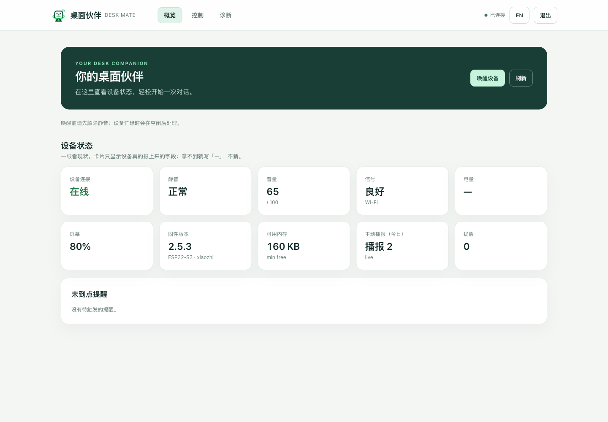
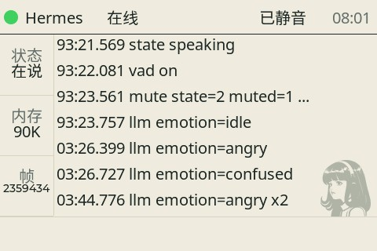
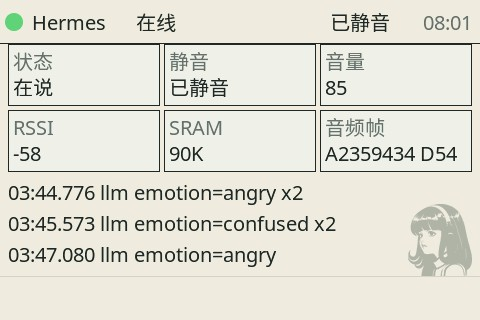
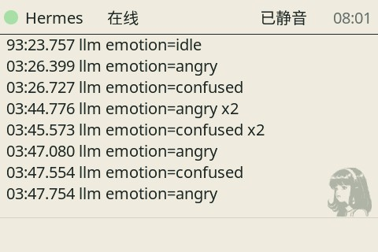
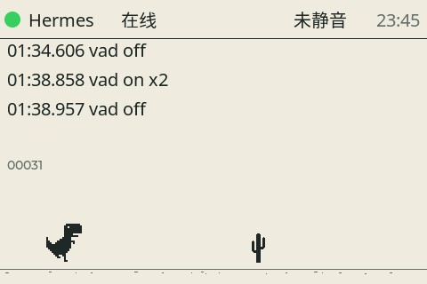

# Desk Mate / 桌面伙伴

ESP32 Voice Entry

[中文](#中文) · [English](#english)



*控制台预览，画面中的设备状态为演示数据。 / Console preview with example device data.*

### 板载屏幕视图 / Device screen views

| A · 状态与日志 / Status & activity | B · 状态卡片 / Status cards |
| :---: | :---: |
|  |  |
| **C · 日志 / Activity log** | **D · 恐龙游戏 / Dino game** |
|  |  |

*均为实机截图；D 为 2026 年 10 月 29 日拍摄。 / Captured on the device; view D was captured on October 29, 2026.*

## 中文

**给桌面添一个能听、能看、会说话的 AI 伙伴。** Desk Mate 将 ESP32-S3 设备、语音服务和网页控制台连接在一起，让你用唤醒词开启对话，也能通过屏幕和摄像头与 AI 互动。

- 语音唤醒、识别、回答、语音播报和打断。
- 表情、屏幕视图、音量控制，以及支持的设备工具。
- 浏览器控制台：查看设备状态、管理静音、远程唤醒和截图。
- 可选择本地或兼容的云端模型服务，按自己的环境配置。

### 开始使用

你需要一块兼容的 ESP32-S3 设备、一台运行服务的电脑、同一局域网和语音模型。按照[部署指南](docs/deployment.md)配置服务与设备，然后在浏览器访问 `http://<服务电脑地址>:4411/admin`。控制台提供中英文切换。

本项目的服务端和[设备固件](https://github.com/yes999zc/xiaozhi-esp32)分别发布。固件发布包面向 `chd-esp32s3-box-lcd35`；使用其他板型时请先确认兼容性。公开固件不包含你的私有设备令牌，部署时需要完成配对。

### 让 AI 陪你部署

把下面的提示词复制给有终端访问能力的 AI 助手，按提示提供自己的环境信息即可：

```text
请作为我的部署助手，帮助没有单片机经验的我部署 Desk Mate（ESP32 Voice Entry）。
先阅读本仓库 README、docs/deployment.md、config.example.yaml 和相关脚本，
再检查我的操作系统、Python、ESP32 板型、串口、网络和已有模型。
根据实际情况逐步指导或执行服务安装、模型配置、设备配对、刷机和连接测试。
每一步用简单中文解释目的和结果；缺少信息时问我，不要猜测硬件或路径。
密钥、Wi-Fi 密码和令牌只保存在本地，不要输出或提交到 Git。
在擦除存储、覆盖配置或刷机前说明影响，并先备份及征得我的同意。
最后帮我打开控制台，验证设备连接、静音和唤醒，并给出日常启动方法。
```

### 致谢

感谢 [xiaozhi-esp32](https://github.com/78/xiaozhi-esp32)、[ESP-IDF](https://github.com/espressif/esp-idf)、[ESP-SR](https://github.com/espressif/esp-sr)、[LVGL](https://lvgl.io/)、[sherpa-onnx](https://github.com/k2-fsa/sherpa-onnx)、[Opus](https://opus-codec.org/) 及小智社区的维护者和贡献者。本项目站在这些开源工作的基础上。

## English

**An AI companion for your desk that can listen, see and speak.** Desk Mate brings an ESP32-S3 device, a voice service and a browser console together for wake-word conversations and screen or camera interactions.

- Wake-word detection, speech recognition, responses, speech playback and interruption.
- Expressions, screen views, volume control and supported device tools.
- A browser console for device status, mute, remote wake and screenshots.
- Configurable local and compatible cloud model services.

### Get started

You need a compatible ESP32-S3 device, a computer to run the service, a shared local network and speech models. Follow the [deployment guide](docs/deployment.md), then open `http://<server-address>:4411/admin`. The console supports English and Chinese.

The service and [device firmware](https://github.com/yes999zc/xiaozhi-esp32) are released separately. Firmware releases target `chd-esp32s3-box-lcd35`; check compatibility before using another board. Public images do not include your private device token, so pair the device during setup.

### Deploy with an AI assistant

Copy this prompt to an AI assistant with terminal access:

```text
Please help me deploy Desk Mate (ESP32 Voice Entry) as a beginner.
First read this repository's README, docs/deployment.md, config.example.yaml,
and relevant scripts. Inspect my OS, Python, ESP32 board, serial port, network,
and available models before proposing steps. Guide me through or perform setup,
model configuration, device pairing, flashing, and connection checks.
Explain each step in plain English and ask when information is missing; do not
guess hardware or paths. Keep keys, Wi-Fi passwords and tokens local: never print
or commit them. Before erasing storage, overwriting configuration or flashing,
explain the impact, make a backup and ask for my approval. Finally, open the
console, verify the device connection, mute and wake, and explain how to start it.
```

### Acknowledgements

Thank you to the maintainers and contributors of [xiaozhi-esp32](https://github.com/78/xiaozhi-esp32), [ESP-IDF](https://github.com/espressif/esp-idf), [ESP-SR](https://github.com/espressif/esp-sr), [LVGL](https://lvgl.io/), [sherpa-onnx](https://github.com/k2-fsa/sherpa-onnx), [Opus](https://opus-codec.org/) and the XiaoZhi community.

## License / 许可证

[MIT](LICENSE). Upstream components retain their own licenses and attribution.
