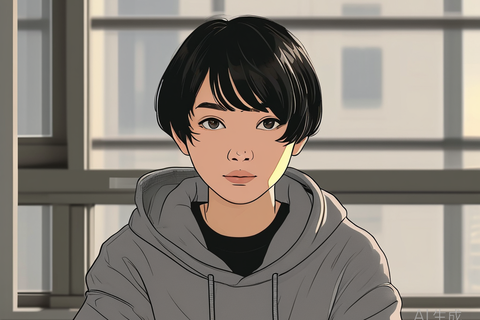
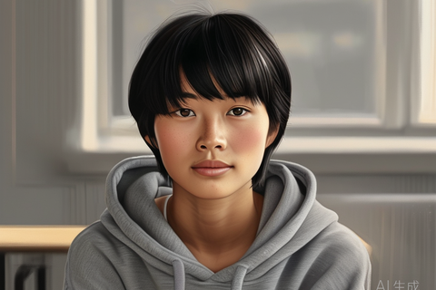
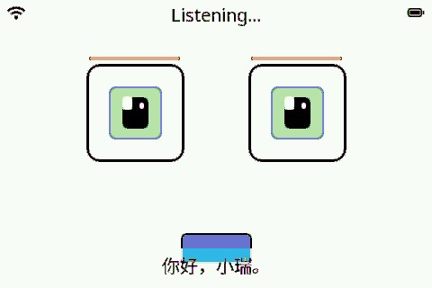

# 形象选型：日漫 / 半写实 / 当前 kawaii —— 样图 + 三条管线对比

- 日期：2026-10-28
- 范围：只出样图 + 选型表。**不做形象、不改固件/协议、不刷机、不 commit。**
- 前置：`docs/persona-asset-pipeline.md`（管线/带宽/许可调研）、`docs/persona-research.md` §7、`docs/face-ui-research.md`。
- 本文回答：**同一角色、同一姿态、同尺寸**下，日漫与半写实看起来差多少、各自走哪条管线、要多少人日与多少预算，方便 9哥 一次拍板。
- 所有 flash / PSRAM / 帧率数字**引自 `docs/persona-asset-pipeline.md`**，本文不重新拍数。

## 0. 结论（一句话）

**推荐管线 = 分层底图 + 贴片**（唯一同时满足「跑得动 + 保留字幕 + 许可干净」的路线）；**档位（日漫 / 半写实 / 照片级）待 9哥 定**——半写实更像人但要 +5–10 人日美术，日漫 2–5 人日即可，两者运行时是同一套，换档只换美术资产。

## 1. 三张样图

> **样图是风格参考，不是最终素材。** 三张都是 480×320（与 CHD 屏同尺寸），但**只能作风格参考；布局以 §2 为准**：两张 AI 样图**未叠加**实际 464×84 字幕条与 480×228 脸区安全框，而 `face-current.png` 含字幕条，两者不能直接当布局对比。最终形象需委托/授权素材重制。

### 1.1 日漫（目标档位 A）

- 480×320 PNG，风格：干净赛璐璐平涂、描边、动漫眼。
- 观感：亲和、辨识度高、缩到 480 宽仍清晰；不像真人，但「伙伴感」足够。

### 1.2 半写实（目标档位 B）

- 480×320 PNG，风格：半写实厚涂、皮肤质感/毛孔、自然光影。
- 观感：明显更像人；但 480×320 下细节会被压缩，缩略后优势不如大图明显，且美术成本高 2–3×。

### 1.3 当前真机（基线）

- 480×320 PNG，来源 `docs/face/step1-neutral.jpg`（CHD 真机截图，LVGL kawaii 脸 + 字幕条 + 状态栏），仅转码不重绘。
- 作用：基线对照 —— 任何新形象至少不能比它更糊、更不能丢字幕。

### 1.4 样图生成方式（可复现，非手工挑选）

| 项 | 值 |
|---|---|
| 模型 / 接口 | SiliconFlow `Kwai-Kolors/Kolors`，`/v1/images/generations` |
| 参数 | `image_size=1024x768`、`batch_size=1`、`seed=42`、`num_inference_steps=30` |
| 共同角色/姿态 | 同一段描述：短黑 bob、圆脸、平静表情、看镜头、灰连帽衫、坐书桌前、柔和窗光、暖灰背景、居中半身、3/4 侧 |
| 风格词（唯一差异） | 日漫：`Japanese anime style, clean cel shading, expressive eyes, soft line art, flat colors`；半写实：`semi-realistic digital painting, natural skin texture, soft shading, realistic proportions, cinematic lighting` |
| 后处理 | 中心裁 3:2（1024×683）→ LANCZOS 缩到 **480×320** → PNG |
| 水印 | 源图右下角带「AI 生成」字样，缩图后仍在（如实保留，避免误当成品） |

> 同 seed + 同构图描述下两张图人物/姿势/取景一致，可直接做 A/B 观感对比；**注意 AI 图不是交付素材**，正式素材须走委托或 CC-BY（见 §4 许可）。

## 2. 三条管线总表

| 维度 | 1. `.eaf`（esp_emote） | 2. Live2D（Cubism 运行时） | 3. **分层底图 + 贴片** |
|---|---|---|---|
| 代表项目/工具 | Espressif `esp_emote_assets` + `esp_emote_expression`（`espressif2022/esp_emote_expression ^1.0.2`，`main/idf_component.yml:77`） | Live2D Cubism Editor + Cubism SDK for Native | 纯 LVGL：`lv_image` + 定时器/动画（`main/display/lcd_display.cc:1229-1250` 现有 `SetEmotion()` 可换图/GIF，但不是分层实现） |
| 链接 | <https://github.com/espressif2022/esp_emote_assets> | <https://docs.live2d.com/en/cubism-sdk-manual/platform/> · <https://www.live2d.com/en/sdk/license/> | <https://lvgl.io/> · <https://github.com/lvgl/lvgl> |
| 现状（一句话） | **能跑**：官方 320_240 变体可编译，CHD 板 `ChdEmoteDisplay` 是现成编译期变体 | **本板不能跑**：无 Xtensa/FreeRTOS 运行时、S3 无 GPU（0 fps） | **未实现**：现有 kawaii 是程序化绘制（可作回退基线）；分层贴片需新建 `lv_image` 层（1–2 人日代码），无需新组件 |
| 许可 | manifest 声明 Apache-2.0，但组件目录**未附 LICENSE**、官方 emoji 素材**无专项授权** → 商用前需书面确认 | SDK：年销 <1000 万日元免费商用，超出需签约；Core 闭源。官方 sample 模型需署名、禁再分发原素材、部分非商用；烘帧进硬件属灰区 | 自有/委托最干净；CC-BY 需署名；真人照片高风险（肖像权） |
| 480×320 可行性 | 官方只有 1024_600/360_360/**320_240**，无 480×320；`layout.json` 坐标硬编码，宽屏脸偏左上；`emoji_large` 为 125×160 竖构图，铺满 480 宽需重制 480×228 EAF 或自写 layout | Editor 侧任意分辨率，但板端无运行时；纹理 1024² 也要 4.2 MB 解码，画质收益被 480 px 脸区抵消 | **1:1 原生 480×228 脸区 + 464×84 字幕条**，无缩放损失（板级布局 `chd_esp32s3_box_board.cc:366-374`） |
| flash | 3.3–5.0 MB / 8 表情（480×228 重制）；21 表情 8.7–13 MB 超 6.31 MiB 余量 | —（板端不部署） | **≤0.3 MB 预算**（底图 10–24 KB + 20 个 patch raw ≈180–200 KB） |
| PSRAM | ~110–150 KB（按 `block_height=32` 分块解码） | 纹理解码 4.2–16.8 MB → **超 8 MB** | **<0.6 MB**（draw buffer 19 KB 在内部 SRAM） |
| 帧率 | **15–20 fps**（SPI 上限 22.8，组件默认 20） | **0 fps**（无运行时）；软件光栅化理论上限 10–20 fps，但许可不允许重写 Core | **30 fps 目标/上限**（眼 4.3 ms、嘴 2.4 ms 脏矩形；未实测）；整脸换表情 ≈20 fps 上限 |
| 实现代价 | 3 人日（`esp_lv_eaf_player` 变体，保留字幕）；若走 `esp_emote_expression` 接管 panel 则丢字幕/状态栏 | 板端 0 人日（不可行）；仅可当**离线作者工具** → 渲 PNG 序列再转 EAF/分层 | **1–2 人日代码 + 美术工时**；预算档 **M**（委托 1 套分层立绘） |
| 失败模式 | 放大糊、8-bit 调色板色带、layout 硬编码偏移、整屏接管丢字幕、帧数不足时循环动作假、IDF 6.1 未验证 | Core 无法移植 → 授权链断裂 → 纹理超 PSRAM → 无 GPU 帧率崩 | 接缝/色差、层序（头发要盖眼）、只有位移无转头、美术质量决定上限、RGB565 无 alpha（须 RGB565A8）、JPEG 边缘彩边（patch 用 PNG） |

**带宽硬约束（解释为什么整屏方案都不行）**：SPI 40 MHz ≈ 5.0 MB/s；全屏 480×320×2 B = 307 KB → **16.3 fps 上限**；脸区 480×228 → 22.8 fps。所以「每帧重刷整屏」到不了 20 fps，只有脏矩形局部刷新才有机会 30 fps（`docs/persona-asset-pipeline.md` §1.3）。

### 2.1 `.eaf` 补充

- 官方 20 个逻辑表情只映射到 **9 个 distinct src**，默认 20 fps；磁盘 10 支 EAF 共 1.18 MB，折算 **0.095 B/px/帧**。
- 官方素材 125×160 竖构图在 480 宽下只能显示 178×228（横向空 302 px），要么裁切要么自写 480×228 EAF —— 意味着**官方素材拿来即用不成立**，仍要美术重制。
- 适合做 2–3 个 hero 动画（听/说/思考的整段动作），**不适合当主线**。

### 2.2 Live2D 补充

- 平台表只有 Windows/macOS/Linux/Android/iOS/HarmonyOS，Native 仅 64-bit，渲染引擎 OpenGL/Metal/DirectX/Vulkan —— **没有 Xtensa/FreeRTOS、没有 GPU**。
- 唯一用法：**离线**用 Cubism Editor 建模 → 渲成 PNG 序列 → 转 EAF 或分层贴片。这条路许可与烘帧仍是灰区，仅限原型。

### 2.3 分层贴片补充

- 素材：1 张 480×228 底图 + 眼/嘴/眉/腮红 patch（PNG→RGB565A8）。
- 12 个核心 patch ≈155 KiB，20 个 ≈180–200 KB raw；底图 JPEG q80 ≈10–24 KB。
- 保留字幕条与状态栏、不动 panel、不动协议，**回退开关**可一键切回 kawaii。
- 风险主要在美术质量与层序，不在固件。

## 3. 三档「真人程度」→ 管线与周期

| 档位 | 管线 | 本板帧率 | flash | 周期（美术+集成） | 许可 | 判断 |
|---|---|---|---:|---|---|---|
| **照片级·预烘** | 480×228 JPEG 帧序列 | 8–10（解码 100–120 ms/帧，估算） | 6.31 MiB ÷ ≈16 KB/帧 ≈ 403 帧（8–10 fps 约 40–50 s） | 拍摄/修图 + 打包链路 | **最高风险**（肖像权/深度合成标识） | 不推荐 |
| **照片级·推流** | 服务器 JPEG over WS/UDP | 12（目标码率；22.7 KB×12≈272 KB/s） | 0 | 6 人日；当前 WS 数十秒被断 | **最高风险** | 不推荐（链路不稳） |
| **半写实** | Blender/VRM 渲 2D → 分层贴片 | 30（目标） | 0.4–0.6 MB | 3D 建模/绑定 5–10 人日（日漫 2–3×） | 自有/委托，干净 | 可选（像人优先） |
| **日漫·分层** | 差分立绘/CC-BY → 分层贴片 | 30（目标） | ≤0.3 MB（预算） | 美术 2–5 人日 + 集成 1–2 人日 | 最干净 | **低成本默认** |
| **日漫·EAF** | 官方/自渲 EAF | 15–20 | 3.3–5.0 MB | 3 人日 + 素材 | 素材需书面确认 | 备选 |

> **实时照片级在这块板上不存在**：分辨率 × 帧率 × SPI 带宽三者互斥，只能预烘短片或服务器推帧，而推流链路当前不稳（`docs/persona-asset-pipeline.md` §6）。
>
> **9哥 已定（2026-10-28 17:4x）：日漫风**；半写实/照片级不采用。日漫是选定档位；实现仍待后续卡，本轮只出图与结论。

## 4. 推荐与取舍

### 4.1 推荐：分层底图 + 贴片

1. 只有它能靠脏矩形把眼/嘴做到 **30 fps 目标**（§1.3 带宽推导），整脸换表情仍 ≈20 fps。
2. **flash ≤0.3 MB、PSRAM <0.6 MB**，给字幕/状态栏/唤醒词留足余量；不动 panel、不动协议。
3. 许可链最短：委托买断或 CC-BY（署名进 README/关于页），避开真人肖像与 Live2D 商用灰区。
4. 档位可后置：**同一套运行时既吃日漫立绘，也吃半写实渲染图**，换档只换美术资产。
5. Live2D 只当离线作者工具；EAF 作 2–3 个 hero 动画补充，不作主线。

### 4.2 日漫 vs 半写实：像人 vs 成本

| 取舍点 | 日漫 | 半写实 |
|---|---|---|
| 像人程度 | 中（可爱、伙伴感强） | **高**（明显像真人） |
| 480×320 下观感 | **优势**：平涂+描边缩图不糊 | 优势被压缩：细节/毛孔在 480 宽基本看不见 |
| 美术成本 | 2–5 人日（1 张立绘分层即可开工） | **5–10 人日**（3D 建模/绑定/渲 2D，日漫 2–3×） |
| flash | ≤0.3 MB | 0.4–0.6 MB（多套表情更吃空间） |
| 许可/合规 | **最干净**（委托/CC-BY） | 干净，但若照真人照片建模则重新落入肖像权问题 |
| 失败风险 | 低：风格容错大，接缝/色差可被描边掩盖 | 中高：半写实对层序、色差、光影一致性极敏感，做不好会「恐怖谷」 |
| 适合谁 | 预算优先 / 先跑通体验 | 坚持「像人」/ 有 3D 美术资源 |

**一句话**：如果目标是「先让设备有个能看、能动能反应的形象」，**日漫分层是性价比最优解**；如果 9哥 认为「不像人就没有陪伴感」，再上半写实，但要多预留 2–3 倍美术时间，并接受 480×320 下细节损失。

## 5. 拍板小表（给 9哥 直接选）

| 方案 | 是否需要实现 | 预算档（估算） | 周期（估算） | 风险 | 建议 |
|---|---|---|---|---|---|
| A. 日漫 + 分层贴片 | **需要**（新任务卡） | **M**：委托 1 套分层立绘 + 1–2 人日集成 | 约 1–2 周（美术 2–5 人日串行） | 低（许可干净、带宽够） | ✅ **推荐** |
| B. 半写实 + 分层贴片 | **需要**（新任务卡） | **L**：3D 建模/绑定 + 渲 2D + 集成 | 约 2–4 周（5–10 人日） | 中（美术返工、色差/层序） | 可选，若「像人」优先级最高 |
| C. 日漫/官方素材 + EAF | 需要（改播放器变体） | **M**：3 人日集成 + 素材确认 | 约 1 周 | 中（素材授权未明、放大糊、可能丢字幕） | 仅作 hero 动画补充 |
| D. Live2D 板端运行 | **不需要**（本板不可行） | — | — | 高（无运行时/无 GPU/许可灰区） | ❌ 不做；只可离线出图 |
| E. 照片级（预烘/推流） | 不建议 | **L+**（拍摄/合规/链路） | 3–6 周 | **最高**（肖像权、深度合成标识、带宽） | ❌ 本阶段不做 |
| F. 维持现状（kawaii 脸） | 不需要 | **S**（0） | 0 | 低 | 作为回退基线保留 |

> 预算档为**量级估算**（S=0 / M=数千元内委托 / L=万元级 3D+美术），非报价；人日引自 `docs/persona-asset-pipeline.md` §2–§6。

## 6. 与既有调研的一致性

- 推荐管线 = **分层底图 + 贴片** ✔ 与 `docs/persona-asset-pipeline.md` §7 一致。
- **Live2D 本板不可跑（0 fps）** ✔ 与 §3 一致。
- **日漫 / 半写实档位未定，待 9哥** ✔ 与 §7、`docs/persona-research.md:282-289` 一致。
- EAF 可跑但观感受素材限制、需书面确认授权 ✔ 与 §2 一致。
- 本文**没有**新增实测数字；帧率/体积/带宽均引用上表来源。

## 7. 来源

- 管线与数字：`docs/persona-asset-pipeline.md`（§0 结论表、§1.2 flash 余量、§1.3 带宽、§2 EAF、§3 Live2D、§4 分层、§5 许可、§6 三档、§7 推荐）。
- 档位未定：`docs/persona-research.md:282-289`；9哥 原话：`docs/face-ui-research.md:4`。
- 板级布局/现有换图能力：`main/boards/chd/chd-esp32s3-box/chd_esp32s3_box_board.cc:366-374`、`main/display/lcd_display.cc:1229-1250`（固件仓 `05_Tools/xiaozhi-esp32/`）。
- EAF 组件与素材：<https://github.com/espressif2022/esp_emote_assets>（manifest 声明 Apache-2.0，目录未附 LICENSE）；`main/idf_component.yml:77`。
- Live2D：[平台支持](https://docs.live2d.com/en/cubism-sdk-manual/platform/) · [SDK 许可](https://www.live2d.com/en/sdk/license/) · [Free Material License §4.1.1](https://www.live2d.com/eula/live2d-free-material-license-agreement_en.html) · [sample model terms](https://www.live2d.com/eula/live2d-sample-model-terms_en.html) · [授权帮助](https://help.live2d.com/tag/tag_-agreement/)
- LVGL：<https://lvgl.io/> · <https://github.com/lvgl/lvgl>
- 样图：SiliconFlow `Kwai-Kolors/Kolors`（seed 42，1024×768 → 裁 3:2 → 480×320），2026-10-28 生成；`face-current.png` 由 `docs/face/step1-neutral.jpg` 转码。
